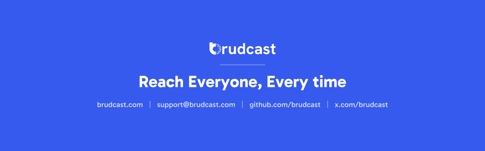

# Brudcast React Native SDK



In-app messaging and push notifications for React Native apps on Brudcast, on Android and iOS. The
packages run the native [Android](https://github.com/brudcast/brudcast-sdk-android) and
[iOS](https://github.com/brudcast/brudcast-sdk-ios) SDKs: rendering, storage, networking, the event
queue and triggers stay native, and TypeScript forwards calls to them.

| Package                                                         | What it does                                                                |
| --------------------------------------------------------------- | --------------------------------------------------------------------------- |
| [`@brudcast/react-native`](packages/react-native)               | Core: configuration, identity, events, the action handler. Always needed    |
| [`@brudcast/react-native-in-app`](packages/react-native-in-app) | In-app messages, the inbox, `useInbox` and `<BrudcastInboxMessage>`         |
| [`@brudcast/react-native-push`](packages/react-native-push)     | Push: the FCM token from React Native Firebase, permission, the Expo plugin |

Each package has its own native dependency, so a push-only app never ships the in-app renderer.
The packages share one version with the native SDKs they run. They are TurboModules and Fabric
components for the New Architecture, React Native 0.86 and later, bare or Expo with a development
build.

Start with the [`@brudcast/react-native` README](packages/react-native/README.md).

## Example app

[`example`](example) is a small app built the way a customer's app would use the SDK: sign-in
through a backend that computes the user hash, a shop with checkout events, an inbox built with
`useInbox`, and an account screen. See its [README](example/README.md).

## Develop

The repository is a Yarn workspace holding the three packages and the example.

```sh
yarn install
yarn typecheck && yarn lint && yarn test
```

The bridge between TypeScript and native code is generated by React Native's codegen from
`src/specs` in each package when the example builds. After changing a spec, update the Kotlin and
Objective-C++ modules that implement it.

The iOS podspecs compile a vendored copy of the native iOS SDK. [RELEASING.md](RELEASING.md)
explains why and how to update it.

### Run the example

```sh
cp example/config/local.json.example example/config/local.json
(cd example/ios && RCT_USE_RN_DEP=1 RCT_USE_PREBUILT_RNCORE=1 pod install)
yarn example ios
yarn example android
```

### Against unreleased native SDKs

- **Android:** publish the native SDK to Maven Local, then build with `-PbrudcastMavenLocal=true`:

  ```sh
  (cd ../brudcast-sdk-android && ./gradlew publishToMavenLocal -PsdkVersion=0.2.0)
  (cd example/android && ./gradlew assembleDebug -PbrudcastMavenLocal=true)
  ```

- **iOS:** vendor from a checkout and reinstall the pods:

  ```sh
  BRUDCAST_IOS_SDK_PATH="$PWD/../brudcast-sdk-ios" yarn vendor:ios
  (cd example/ios && pod install)
  ```

[RELEASING.md](RELEASING.md) covers publishing to npm.

## Security

Report vulnerabilities privately as described in [SECURITY.md](SECURITY.md), never in a public issue.

## License

Apache License 2.0. See [LICENSE](LICENSE) and [NOTICE](NOTICE).
